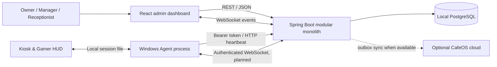
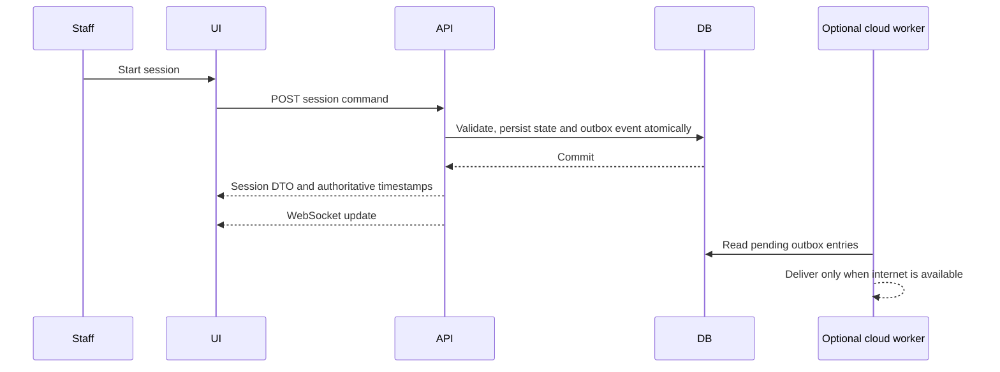

# CafeOS architecture

## Goals and boundaries

The initial deployment is one cafe, with the owner's Windows computer hosting the local application and database. Local operations must remain usable without internet. Cloud services are optional and must never become a dependency for live session timing or billing. The backend is a modular monolith; modules share one PostgreSQL database and are separated by business responsibility.

## Components

- **Frontend** (`frontend`): staff UI, navigation and presentation. It does not decide authoritative elapsed time or price. TanStack Query owns server state; API calls go to `/api` (relative path) and the Vite dev server proxies to `localhost:8080`, making the UI work identically on localhost, LAN IPs, and VS Code Dev Tunnel URLs.
- **Overview activity:** the dashboard reads the same branch session history endpoint used by the session page, refreshes it every five seconds, and presents recent session states. It does not maintain a second activity store.
- **Backend** (`backend`): REST boundary, temporary Basic/device bearer authorization, business services and persistence. Controllers validate DTOs and delegate. Session state changes use transactions and row locks; expiry is recalculated from stored UTC timestamps after restart. `server.address: 0.0.0.0` binds the server to all interfaces; CORS allows origin patterns for `localhost`, `127.0.0.1`, `192.168.*.*`, `10.*.*.*`, and `172.*.*.*`.
- **PostgreSQL**: authoritative local store. Flyway owns schema changes; Hibernate validates but never creates or updates tables. UUID identifiers, UTC instants and decimal currency values are used.
- **Windows Agent / Kiosk Client** (`pc-agent`): the Python process (`python -m agent.ui`) registers a PC, sends authenticated CPU/memory heartbeats over the cafe LAN, and implements a Hardened Kiosk with three states: (1) **Hardened Lock Screen** — low-level `WH_KEYBOARD_LL` Windows hooks block Win key, Alt+Tab, Alt+Esc, Ctrl+Esc, and Alt+F4; (2) **Gamer HUD** — fullscreen overlay with pill mode and audible alerts at 10 m/5 m/1 m remaining; (3) **Step-Away PIN lock** — triggered when the gamer steps away mid-session. Staff bypass via `Ctrl+Shift+F12` + admin PIN. Session state is exchanged via a local session file.
- **Customer profiles**: `Customer` JPA entity and `CustomerRepository` are live. Customers are auto-provisioned on session start when `customerName`/`customerPhone` are provided; `gaming_sessions.customer_id` is an active foreign key.
- **Cloud sync**: future optional outbox consumer. Local writes create durable sync events; no multi-master writes in the MVP.

## Backend module boundaries

`auth` is still a development Basic placeholder; `cafe` and `branch` own tenant and location metadata; `pc` owns inventory and status; `agent` owns device tokens and heartbeat receipt; `pricing` owns hourly rates; `session` owns the authoritative start/pause/resume/extend/end state machine and amount due; `customer` is implemented (Customer entity, CustomerRepository, auto-provisioning on session start, live `customer_id` FK on sessions); `payment`, `reports`, `sync`, and `websocket` are planned modules. `common` provides API errors and shared primitives; `config` wires infrastructure. Modules should expose application services rather than depend on each other's persistence internals.

## Reliability and security

The partial unique index on open sessions protects the one-session-per-PC invariant even when requests race. Session commands also need row-level locking or equivalent optimistic concurrency and transactions. Agent tokens are issued for a PC, stored hashed, rotated by re-issuance, and accepted only on agent routes. Staff APIs use a single development HTTP Basic account loaded from the local `.env`; replace it with the planned JWT login/refresh flow and role/branch authorization before deployment. Agent traffic currently uses HTTP on the LAN; TLS, managed secrets, backups, and tested restore procedures are required for deployment.

## Target local and cloud data flow (session flow planned)

## Decisions

Hourly billing only; Windows 10/11 gaming PCs only; no console support, workstation locking, automated game management, payment gateway or microservices in the MVP. API and deployment details are in [API specification](api-specification.md) and [deployment](deployment.md).
