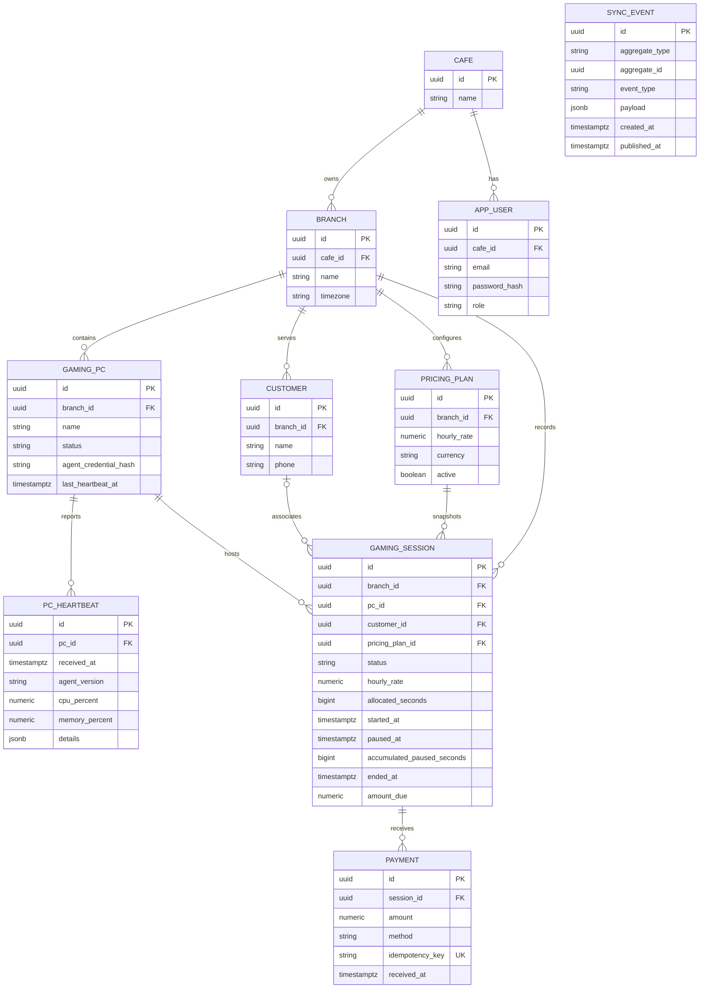

# Database model

All primary keys are UUIDs. Timestamps use `TIMESTAMPTZ` and are stored in UTC. Money uses `NUMERIC(12,2)`. Schema changes are forward-only Flyway migrations.

## Invariants and access paths

- A partial unique index on `gaming_sessions(pc_id)` applies while status is `ACTIVE` or `PAUSED`; it prevents two concurrent open sessions on one PC.
- Session `hourly_rate` is a snapshot so later rate changes cannot rewrite history. Active/paused session command logic must subtract accumulated pauses from elapsed seconds; authoritative expiry belongs to backend timestamps, not client timers.
- Payment `idempotency_key` is globally unique for the initial single-cafe deployment. A duplicate key returns the original payment result after the service verifies the request matches.
- Foreign keys bind each operational row to its branch, PC or session. Reports use `(branch_id, started_at)` and heartbeat history uses `(pc_id, received_at DESC)` indexes.
- `sync_events` is an outbox; event creation must share a transaction with the business write.
- Agent bearer secrets are generated with 256 bits of randomness; only a SHA-256 hex digest is stored in `gaming_pcs.agent_credential_hash`. A partial unique index protects token uniqueness.
- `gaming_pcs.last_heartbeat_at` stores server receipt time. The scheduled liveness check marks `AVAILABLE` PCs `OFFLINE` when their last heartbeat is older than 45 seconds; it does not override `MAINTENANCE` or `OCCUPIED`.

Migrations V1–V4 create the foundation schema, case-insensitive cafe/branch/PC name indexes, and agent heartbeat support. Application-level session state transition validation and heartbeat retention/partitioning policies remain future work.
