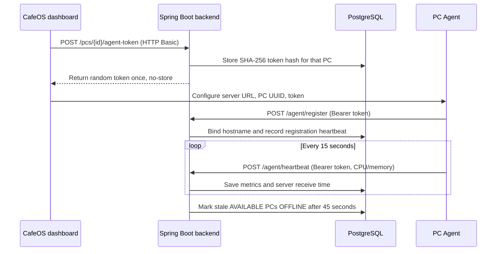

# Windows Agent

The Python agent now supports device registration and heartbeat reporting on Windows 10/11. It is a foreground Python process for development/pilot setup. Windows Service hosting, tray UI, installer packaging, and secure credential storage are not implemented yet.



## Device authentication and data

An admin must provision a PC and issue an agent token from the Gaming PCs page. Tokens contain 256 bits of randomness; PostgreSQL stores only their SHA-256 hash. Issuing another token rotates the credential and immediately revokes the old token. The plaintext token is returned once and is never included in PC list responses. Agent endpoints accept bearer credentials only and derive the PC ID from the authenticated token; clients cannot choose another PC ID in the request body.

Registration sends hostname, OS, IP address, and agent version. Heartbeats report agent status, version, CPU and memory percentages. The backend uses its own UTC receipt time and stores samples in `pc_heartbeats`; the dashboard reads the latest heartbeat timestamp from `gaming_pcs.last_heartbeat_at`. A scheduled check marks a PC `OFFLINE` after 45 seconds without a heartbeat. Heartbeats do not override `MAINTENANCE` or `OCCUPIED` states.

## Run the agent manually

1. On the admin computer, open **Gaming PCs**, issue a token for the target PC, and copy the one-time config.
2. Replace `<ADMIN-PC-LAN-IP>` with the admin computer's LAN address. `localhost` would point to the gaming PC itself.
3. On the gaming PC, copy `pc-agent/.env.example` to `pc-agent/.env` and set the three values from the token panel.
4. Install Python 3.12, then from `pc-agent` run:

   ```powershell
   py -3.12 -m venv .venv
   .venv\Scripts\Activate.ps1
   pip install -r requirements.txt
   python -m agent.main
   ```

The process registers on startup, sends a heartbeat every 15 seconds, and retries connection failures with exponential backoff up to 60 seconds. HTTP 401/403 is treated as a revoked/invalid token and stops retries. Logs never print the token.

## Current limits and next agent work

The `.env` token is plaintext on the PC and transport is HTTP on the local network. Use only on a trusted development LAN; TLS and Windows Credential Manager/DPAPI are required before commercial deployment. The agent currently collects hostname, OS, IP, CPU and memory only. Windows service lifetime management, user-session tray display, WebSocket events, structured log rotation, PyInstaller, and Inno Setup remain future work. Session timing continues to be server-authoritative; this agent does not lock Windows.
