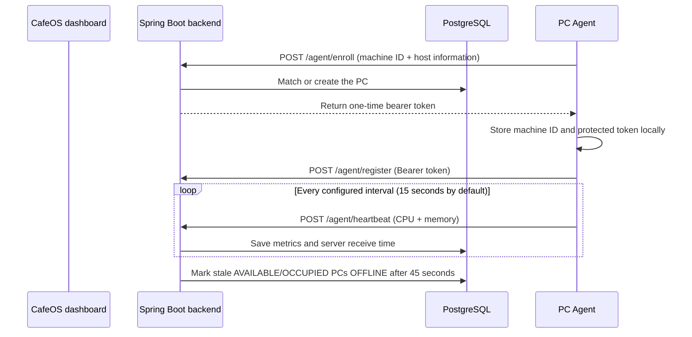

# Windows Agent

The CafeOS agent is a small Python 3.12 process installed on each gaming PC.
It identifies the PC, reports health to the CafeOS server, and keeps the
dashboard liveness information current. The server remains authoritative for
PC state, sessions, pricing, billing, and expiry. The agent does not lock
Windows or calculate billable time.

## Runtime flow



On first launch, the agent:

1. Generates a persistent machine ID.
2. Sends the machine ID, hostname, operating system, IP address, and agent
   version to /agent/enroll.
3. Reuses a matching PC or creates one in the configured branch.
4. Stores the returned token.
5. Registers and starts the heartbeat loop.

If there is only one branch, CAFEOS_BRANCH_ID can be omitted. It is required
when the server has multiple branches. A token is never printed in logs.

## Token storage

The agent tries these stores in order:

1. Windows Credential Manager through keyring.
2. Windows DPAPI-protected local storage.
3. Plaintext state storage only when
   CAFEOS_ALLOW_PLAINTEXT_TOKEN_FALLBACK=true.

The plaintext fallback is intended only for local development environments
where Credential Manager and DPAPI are unavailable. It should remain false
for a deployed cafe PC. The server stores only a SHA-256 hash of the token.

The machine ID and PC ID are stored in:

%LOCALAPPDATA%\CafeOS\agent-state.json

## Running modes

### Foreground mode

From pc-agent:

```powershell
py -3.12 -m venv .venv
.venv\Scripts\Activate.ps1
pip install -r requirements.txt
Copy-Item .env.example .env
python -m agent.main
```

Use requirements-windows.txt when installing the Service and tray
dependencies:

```powershell
pip install -r requirements-windows.txt
```

### Windows Service

The Service entry point is in agent/service.py and uses pywin32:

```powershell
python -m agent.service install
python -m agent.service start
python -m agent.service stop
python -m agent.service remove
```

The Service responds to Windows stop requests and shuts down the heartbeat
loop cleanly. Run it under an account that can access the configured server
and its protected token store.

### Tray mode

The optional tray process is a user-session status surface:

```powershell
python -m agent.tray
```

It starts the agent in the background and provides a quit action. It does not
control sessions or billing. A production deployment should normally run the
Service for reliability and the tray only for user-visible status.

### Session display

The interactive session display runs in the logged-in Windows user session:

```powershell
python -m agent.ui
```

It reads the status snapshot written by the background agent and displays an
idle screen when no session is active. For an active session it shows the
plan, hourly rate, status, start time, expiry time, and a server-authoritative
countdown. Active countdowns use the expiry timestamp between refreshes;
paused sessions stop counting down. The display is presentation-only and has
no controls for changing or ending a session.

### Standalone build

CafeOSAgent.spec defines the PyInstaller foreground build:

```powershell
pip install pyinstaller
pyinstaller --clean CafeOSAgent.spec
```

An Inno Setup installer is still outstanding.

## Configuration

| Variable | Purpose | Default |
|---|---|---|
| CAFEOS_SERVER_URL | CafeOS API base URL | http://localhost:8080 |
| CAFEOS_BRANCH_ID | Branch for automatic enrollment | empty |
| CAFEOS_PC_ID | Optional expected PC identity | empty |
| CAFEOS_AGENT_TOKEN | Optional manually supplied token | empty |
| CAFEOS_HEARTBEAT_INTERVAL_SECONDS | Heartbeat interval | 15 |
| CAFEOS_REQUEST_TIMEOUT_SECONDS | HTTP request timeout | 10 |
| CAFEOS_VERIFY_TLS | Verify HTTPS certificates | true |
| CAFEOS_AGENT_VERSION | Version sent to the API | 0.2.0 |
| CAFEOS_LOG_LEVEL | DEBUG, INFO, WARNING, or ERROR | INFO |
| CAFEOS_LOG_FILE | Optional rotating log path | empty |
| CAFEOS_ALLOW_PLAINTEXT_TOKEN_FALLBACK | Development-only token fallback | false |

For a gaming PC, use the administrator computer's LAN IP in
CAFEOS_SERVER_URL; localhost refers to the gaming PC itself.

## Reliability behavior

- HTTP requests use a bounded timeout.
- Connection failures retry with exponential backoff up to 60 seconds.
- A 401/403 clears the cached token and starts enrollment again.
- Shutdown interrupts the wait immediately rather than waiting for the next
  heartbeat interval.
- State writes use a temporary file, flush, and atomic replace to avoid
  corrupting the machine identity or PC ID after a crash.
- Optional file logs rotate at 5 MB and retain three backups.

## Current limits and next work

Enrollment is currently unauthenticated and intended for a trusted
development/pilot LAN. Before commercial deployment, add TLS everywhere, an
enrollment approval or pairing step, formal token revocation, installer
automation, and production service-account credential validation.

WebSocket event delivery, reconnect reconciliation, richer diagnostics,
structured health reporting, and Inno Setup packaging remain future work.
