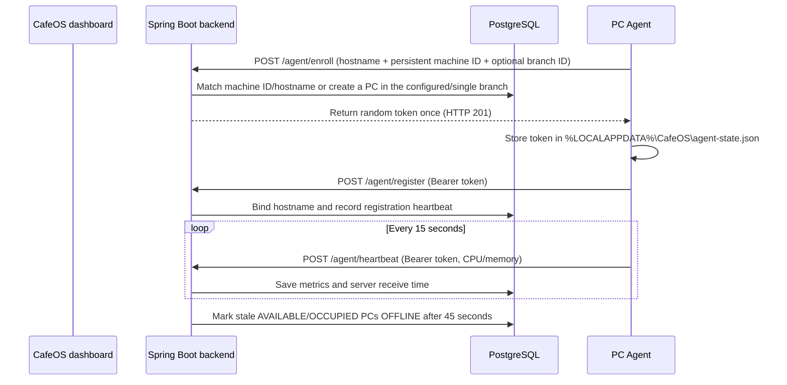

# Windows Agent

The Python agent supports zero-touch device enrollment and heartbeat reporting on Windows 10/11. It is a foreground Python process for development/pilot setup. Windows Service hosting, tray UI, and installer packaging are not implemented yet.



## Device authentication and data

On first launch, the agent sends its hostname and a generated persistent machine ID to `/api/agent/enroll`. The server reuses a matching PC or creates one automatically in the configured branch. If no branch ID is configured, the server uses the only branch; configure `CAFEOS_BRANCH_ID` when there are multiple branches. The agent stores the returned token under `%LOCALAPPDATA%\CafeOS\agent-state.json` and uses it automatically on later launches. Tokens contain 256 bits of randomness; PostgreSQL stores only their SHA-256 hash. Agent endpoints accept bearer credentials only and derive the PC ID from the authenticated token; clients cannot choose another PC ID in the request body.

Registration sends hostname, OS, IP address, and agent version. Heartbeats report agent status, version, CPU and memory percentages. The backend uses its own UTC receipt time and stores samples in `pc_heartbeats`; the dashboard reads the latest heartbeat timestamp from `gaming_pcs.last_heartbeat_at`. A scheduled check marks an AVAILABLE or OCCUPIED PC `OFFLINE` after 45 seconds without a heartbeat. Heartbeats do not override `MAINTENANCE` state.

PC deletion is a soft delete so session history remains intact. Archived PCs no longer reserve their machine identity or display name; the same computer can therefore enroll again after deletion.

## Run the agent manually

1. Replace `<ADMIN-PC-LAN-IP>` with the admin computer's LAN address. `localhost` would point to the gaming PC itself.
2. On the gaming PC, copy `pc-agent/.env.example` to `pc-agent/.env` and set `CAFEOS_SERVER_URL`. If the cafe has multiple branches, also set `CAFEOS_BRANCH_ID`.
3. Install Python 3.12, then from `pc-agent` run:

   ```powershell
   py -3.12 -m venv .venv
   .venv\Scripts\Activate.ps1
   pip install -r requirements.txt
   python -m agent.main
   ```

The process enrolls on startup, sends a heartbeat every 15 seconds, and retries connection failures with exponential backoff up to 60 seconds. HTTP 401/403 clears the cached token and attempts enrollment again. Logs never print the token.

## Current limits and next agent work

Enrollment is intentionally unauthenticated and trusts the machine identity/hostname on the local network, so use it only on a trusted development LAN. TLS, an enrollment approval/pairing step, and Windows Credential Manager/DPAPI are required before commercial deployment. The agent currently collects hostname, OS, IP, CPU and memory only. Windows service lifetime management, user-session tray display, WebSocket events, structured log rotation, PyInstaller, and Inno Setup remain future work. Session timing continues to be server-authoritative; this agent does not lock Windows.
